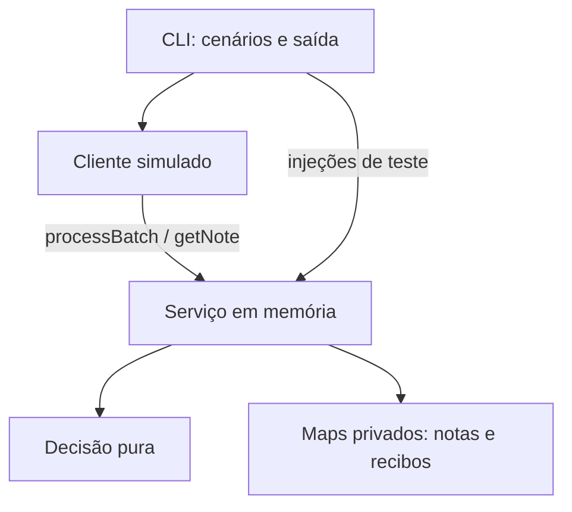

# Caso 05 — Sincronização de notas offline

Biblioteca em memória para sincronização de notas offline, com CLI de demonstração e testes. Foco escolhido: backend, correção do protocolo e arquitetura compreensível. Tarefa oficial: https://github.com/Alvorada-Dev/desafios-tecnicos/blob/bafd3818360af1b9add8f53930824a3de0422b6c/casos/05-sincronizacao-de-notas.md. Caso 05, foco backend/correção, tempo gasto: **PENDENTE — candidato**.

## Como executar

Requisito: Node (versão de `.nvmrc`, 24.13.1) e npm.

```bash
npm ci              # instala as dependências exatas do lockfile
npm run typecheck   # verifica tipos (tsc, sem emitir)
npm test            # executa os testes (vitest)
npm run demo        # executa a demonstração (tsx)
npm run build       # compila src/ para dist/
npm run smoke       # executa a demo compilada (node dist/cli/demo.js)
```

## Demo

A demo (`src/cli/demo.ts`) executa um cenário determinístico com dois dispositivos (A e B):

1. Cria "compras" e "viagem"; A e B consultam a revisão 1.
2. A, offline, edita compras duas vezes e viagem uma vez (vira um rascunho por nota, base 1).
3. B atualiza compras e confirma a revisão 2.
4. A reconecta; o transporte entrega viagem duas vezes (conflito em compras, sucesso e replay em viagem).
5. Injeção direta no servidor: operação inválida e a corrigida com o mesmo ID.
6. A consulta compras e resolve mantendo o texto remoto (nova proposta com base atual).
7. Reenvio do conflito antigo (recibo histórico) contra a consulta atual.
8. Reutilização de ID com outro texto (`id_reutilizado`).

A demo imprime esperado/observado em cada verificação e termina com código diferente de zero se alguma falhar.

Trecho real de `npm run demo` (passos 7 e 8):

```
== Passo 7 — Recibo histórico vs estado atual ==
[OK]     reenvio do conflito antigo devolve o recibo original (revisão 2)
   esperado:  {"status":"conflito","operation":{"op_id":"A-3","note_id":"compras","base_revision":1,"text":"leite, pão, café"},"server_note":{"id":"compras","text":"leite, ovos","revision":2}}
   observado: {"status":"conflito","operation":{"op_id":"A-3","note_id":"compras","base_revision":1,"text":"leite, pão, café"},"server_note":{"id":"compras","text":"leite, ovos","revision":2}}
[OK]     consulta mostra o estado atual (revisão 3)
   esperado:  {"id":"compras","text":"leite, ovos","revision":3}
   observado: {"id":"compras","text":"leite, ovos","revision":3}

== Passo 8 — Reutilização de ID ==
[OK]     mesmo ID com outro texto é rejeitado
   esperado:  {"status":"id_reutilizado","op_id":"A-4"}
   observado: {"status":"id_reutilizado","op_id":"A-4"}
[OK]     viagem continua inalterada
   esperado:  {"id":"viagem","text":"passagens, hotel","revision":2}
   observado: {"id":"viagem","text":"passagens, hotel","revision":2}
```

## Protocolo implementado

```ts
type Note = Readonly<{ id: string; text: string; revision: number }>;
type Operation = Readonly<{ op_id: string; note_id: string; base_revision: number; text: string }>;
```

Resultados possíveis:

- `sucesso`: `{ status: 'sucesso', operation, note }` — a operação foi aplicada.
- `conflito`: `{ status: 'conflito', operation, server_note }` — a revisão base não conferiu; `server_note` é a nota atual ou `null` quando a nota ainda não existe. Exemplo:

```json
{"status":"conflito","operation":{"op_id":"A-3","note_id":"compras","base_revision":1,"text":"leite, pão, café"},"server_note":{"id":"compras","text":"leite, ovos","revision":2}}
```

- `id_reutilizado`: `{ status: 'id_reutilizado', op_id }` — o ID já foi usado com conteúdo diferente.
- `invalida`: `{ status: 'invalida', errors }` — a operação não passou na validação; `errors` lista `{ field, code, message }`.

`conflito` e `id_reutilizado` vêm da tarefa. `sucesso`, `invalida` e o formato dos resultados são escolhas do projeto.

Sequência do servidor, em linguagem simples:

1. Ler e validar a entrada; a operação inválida não ocupa ID nem altera nada.
2. Consultar o recibo por `op_id`: mesmo conteúdo devolve cópia do original; conteúdo diferente devolve `id_reutilizado`.
3. Só para operação válida inédita, consultar a nota atual.
4. Ausente com base 0 cria a revisão 1; existente com base igual à atual troca o texto e soma 1 (mesmo com texto igual); demais combinações conflitam.
5. Montar o resultado; sucesso publica nota e recibo, conflito publica só o recibo.
6. Devolver cópia defensiva.

`processBatch` é sequencial e não transacional: processa na ordem recebida, devolve um resultado por posição, e um erro ou conflito não impede os próximos. `invalida` é correlacionada pela posição no lote, pois pode não haver ID válido.

## Arquitetura



| Pasta | Responsabilidade | Pode importar de |
|---|---|---|
| `src/domain/` | decisão pura (`decideOperation`): aplicar ou conflitar | nada (só tipos locais) |
| `src/application/` | fronteira de entrada, recibos, estado em `Map`s (`createSyncService`) | `src/domain/` |
| `src/client/` | simulador de dispositivo offline | `src/application/` (tipos) |
| `src/cli/` | cenário de demonstração e saída | `src/index.js` (API pública) |

`domain/` é puro: sem relógio, sem estado, sem E/S. O estado vive dentro de `createSyncService()`: cada chamada cria `notes` e `receipts` novos; não há singleton nem `Map` exposto.

## Políticas adicionais

Estas políticas completam o enunciado; não são exigidas por ele.

- Só objetos simples são aceitos (protótipo `Object.prototype` ou `null`); `Date` e instâncias de classe são rejeitados.
- Campos obrigatórios precisam ser próprios (`Object.hasOwn`); cada campo é lido uma única vez.
- IDs não vazios e não só espaços; o valor armazenado não é aparado; comparação exata, sensível a maiúsculas.
- Texto aceita qualquer string, inclusive vazia; espaços e Unicode preservados.
- `base_revision` exige inteiro seguro com `0 <= base_revision < Number.MAX_SAFE_INTEGER`; `-0` vira `0`.
- Campos extras são ignorados sem ter os valores lidos.
- Leitura que lança vira `invalida` com código `unreadable_input` e mensagem fixa, sem expor a exceção.
- Tudo que sai do serviço é cópia defensiva nova, inclusive objetos aninhados e `errors`.
- Lote com envelope ilegível lança `TypeError`.

## Matriz regra → teste

| Regra oficial | Evidência |
|---|---|
| R01: começar sem notas | `tests/sync-service.test.ts` — "T01: servidor inicia vazio e base 0 cria revisão 1" |
| R02: base 0 cria revisão 1 | `tests/sync-service.test.ts` — "T00: exemplo oficial completo com reenvios e reutilização", "T01: servidor inicia vazio e base 0 cria revisão 1" |
| R03: atualizar com base atual, inclusive texto idêntico | `tests/sync-service.test.ts` — "T02: atualização com base atual produz texto e revisão seguintes", "T03: texto idêntico com novo ID também incrementa a revisão", "T04: base antiga, futura ou zero em nota existente conflita e preserva estado" |
| R04: conflito preserva proposta e snapshot ou ausência | `tests/sync-service.test.ts` — "T00: exemplo oficial completo com reenvios e reutilização", "T04: base antiga, futura ou zero em nota existente conflita e preserva estado", "T05: base positiva em nota ausente conflita com server_note null", "T07: reenvio de conflito após resolução devolve o conflito original", "T08: reenvio de conflito por ausência continua com null após criação" |
| R05: validar primeiro; inválida não ocupa ID | `tests/input.test.ts` — "T10: operação inválida seguida da corrigida com mesmo ID permite processar a corrigida", "T11: payload inválido com ID conhecido retorna invalida antes de deduplicar", "T19: entrada inválida ($name) retorna invalida" |
| R06: válida inédita guarda conteúdo e resultado, inclusive conflito | `tests/sync-service.test.ts` — "T06: reenvio de sucesso após mudanças devolve o recibo original", "T07: reenvio de conflito após resolução devolve o conflito original", "T08: reenvio de conflito por ausência continua com null após criação" |
| R07: replay original sem reaplicar | `tests/sync-service.test.ts` — "T00: exemplo oficial completo com reenvios e reutilização", "T06: reenvio de sucesso após mudanças devolve o recibo original", "T07: reenvio de conflito após resolução devolve o conflito original", "T20: operação duplicada no lote retorna replay com um só efeito" |
| R08: mesmo ID com conteúdo diferente é rejeitado | `tests/sync-service.test.ts` — "T09: reutilizar ID com conteúdo diferente é rejeitado e preserva o original", "T21: mesmo ID com conteúdo diferente no lote retorna id_reutilizado" |
| R09: fila em ordem; um resultado por operação; erro/conflito não bloqueia próximas | `tests/sync-service.test.ts` — "T12: lote continua após inválida, conflito e leituras que lançam", "T13: dois clientes com base 1 no mesmo lote — primeira aceita, segunda conflita", "T20: operação duplicada no lote retorna replay com um só efeito", "T21: mesmo ID com conteúdo diferente no lote retorna id_reutilizado" |
| R10: consulta atual separada de recibo histórico | `tests/sync-service.test.ts` — "T00: exemplo oficial completo com reenvios e reutilização", "T06: reenvio de sucesso após mudanças devolve o recibo original", "T07: reenvio de conflito após resolução devolve o conflito original", "T08: reenvio de conflito por ausência continua com null após criação" |
| R11: resolução explícita com novo ID/base atual; sem merge automático/relógio | `tests/sync-service.test.ts` — "T14: resolução explícita com novo ID e base atual funciona" e inspeção de `src/domain/decide-operation.ts` |
| R12: exemplo oficial completo | `tests/sync-service.test.ts` — "T00: exemplo oficial completo com reenvios e reutilização" |

| Política adicional | Evidência |
|---|---|
| Cópias defensivas | `tests/sync-service.test.ts` — "T15: mutar a entrada original após a chamada não altera o servidor", "T16: mutar resultados e consultas não altera o estado interno" |
| Instâncias independentes | `tests/sync-service.test.ts` — "T17: instâncias independentes e lote vazio funcionam" |
| Validação, limites e projeção dos quatro campos | `tests/input.test.ts` — "T18: ordem de campos e campos extras não alteram a identidade", "T19: entrada inválida ($name) retorna invalida" e demais its T19 |
| Cliente não presume revisão | `tests/simulated-client.test.ts` — "T22: limitação — presumir revisão sobrescreve o trabalho de outro dispositivo", "T23a: edições locais repetidas viram um rascunho com base confirmada" e demais its T23 |
| Extensões do cliente e testes adicionais | T24–T27 **Não implementados** (opcionais P2) |

## Testes em destaque

### T07 — replay de conflito após resolução

- Arquivo e nome: `tests/sync-service.test.ts` — "T07: reenvio de conflito após resolução devolve o conflito original".
- O que verifica: após resolver o conflito (revisão 3), o reenvio do conflito antigo devolve exatamente o recibo original, com `server_note` na revisão 2.
- Resultado esperado: recibo de conflito histórico, não recalculado.
- Defeito que detecta: replay recalculado em vez do recibo guardado.

### T11 — inválida antes de deduplicar

- Arquivo e nome: `tests/input.test.ts` — "T11: payload inválido com ID conhecido retorna invalida antes de deduplicar".
- O que verifica: um payload inválido com ID já conhecido retorna `invalida`, sem replay e sem `id_reutilizado`; o recibo original continua válido.
- Resultado esperado: `invalida` com `invalid_type`.
- Defeito que detecta: deduplicação feita antes da validação.

### T16 — cópias defensivas

- Arquivo e nome: `tests/sync-service.test.ts` — "T16: mutar resultados e consultas não altera o estado interno".
- O que verifica: mutar recibos, consultas e `server_note` — inclusive o replay de um reenvio — não altera o estado interno; novos reenvios devolvem os literais originais.
- Resultado esperado: estado preservado (`note('N','original',1)`).
- Defeito que detecta: referências internas vazadas.

Investigação opcional para o candidato: em uma cópia temporária, remover as cópias defensivas e observar T16 falhar; recalcular o replay e observar T07 falhar. **PENDENTE — candidato** (não executado pelo agente).

## Cliente simulado e limitação do protocolo

T22 mostra a limitação: a revisão é só um número, não prova que o dispositivo viu aquele conteúdo. A presume que sua primeira operação vai gerar a revisão 2 e já prepara a segunda com base 2. B confirma a revisão 2 primeiro; A1 conflita e A2 é aceita, sobrescrevendo o texto de B sem que A o tenha visto. O servidor aceita porque o protocolo manda aceitar: base 2 era a atual quando A2 chegou.

O cliente evita isso (T23): guarda o snapshot confirmado, junta edições repetidas num rascunho só com a base confirmada, prepara no máximo uma operação pendente por nota, bloqueia a nota após conflito até `refresh` + `resolveConflict` com texto escolhido, e `refresh` nunca muda a base de um rascunho existente.

Simplificações declaradas: editar durante pendência lança erro local (T24 não implementado); respostas fora de ordem não são tratadas (T27 não implementado); nota bloqueada por `invalida`/`id_reutilizado` não tem API de correção; sem reenvio automático.

## Limites e discussão de arquitetura

- Recibo é histórico e imutável; nota é o estado atual. Consulta atual e recibo histórico podem divergir.
- Validação antes da deduplicação: inválida não ocupa ID; o recibo original só existe para operação válida.
- A seção após a leitura é síncrona, sem `await` ou E/S. Não há mutex porque não há concorrência assíncrona aqui; E/S assíncrona exigiria rever essa fronteira. Não há atomicidade durável; crash, falha do runtime e múltiplos processos não são tratados.
- Getters do chamador executam código do chamador: sem sandbox, sem proteção contra loop infinito e sem rollback dos efeitos desse código; um getter pode chamar o serviço de novo durante a leitura da própria operação; o resultado segue a ordem real das chamadas.
- A memória cresce com notas e recibos, incluindo textos históricos. Busca em `Map` é constante em média, mas ler, comparar e copiar textos custa proporcionalmente ao tamanho deles.
- Um TTL nos recibos mudaria a garantia de replay.
- A deduplicação global por `op_id` vale só para esta instância e sem usuários.

## Evolução para produção

Persistir alteração e recibo de forma coordenada em transação, com atualização condicional por revisão, tratando concorrência no mesmo `op_id` e na criação de nota ausente; isolamento e locking precisam ser definidos. Em ambiente multiusuário, usar `(usuario_autenticado, op_id)` e autorizar notas e recibos, evitando exposição de snapshots por replay. Nada disso está implementado. Não há exactly-once de efeitos externos nem recuperação após crash.

## Uso de IA e autoria

O plano e o código foram produzidos com assistência de um agente de IA, fase a fase, com validação humana antes do commit de cada fase. Escolhas propostas pela IA: formato dos resultados (`sucesso`/`invalida`), políticas de entrada, cópias defensivas, desenho do cliente simulado e cenário da demo.

### Decisões revisadas pelo candidato — PENDENTE DE REVISÃO DO CANDIDATO

#### Decisão 1 — PENDENTE DE REVISÃO DO CANDIDATO
- O que quis conferir: PENDENTE
- Como investigou: PENDENTE
- Conclusão: PENDENTE

#### Decisão 2 — PENDENTE DE REVISÃO DO CANDIDATO
- O que quis conferir: PENDENTE
- Como investigou: PENDENTE
- Conclusão: PENDENTE

Sugestões: a limitação do cliente (repetir T22/T23) e a validação antes da deduplicação (T11).

## Verificação

### Executado pelo agente

Verificação da fase 6 em 2026-09-27T20:05:43-03:00 (instalação limpa após `rm -rf dist`):

| Comando | Resultado real |
|---|---|
| `npm ci` | instalação limpa, 0 vulnerabilidades |
| `npm run typecheck` | sem erros, exit 0 |
| `npm test` | 3 arquivos, 58 testes passed, exit 0 |
| `npm run demo` | 20 verificações `[OK]`, `Todas as verificações passaram.`, exit 0 |
| `npm run build` | sem erros, exit 0; `dist` sem testes |
| `npm run smoke` | saída idêntica à demo, `Todas as verificações passaram.`, exit 0 |

### Verificação humana

**PENDENTE — candidato.**

## Escopo entregue

| Prioridade | Conteúdo | Estado |
|---|---|---|
| P0 — entrega principal | protocolo completo, T00–T21, CLI reproduzível, README, comandos | entregue |
| P1 — cliente simulado | cliente mínimo, T22 (limitação), T23 (prevenção) | entregue |
| P2 — opcionais | T24–T27 e extensões do cliente | não implementado (opcional) |

## Pendências

- Tempo humano (revisão, gravação, envio): **PENDENTE — preenchido pelo candidato.**
- Revisão das duas decisões acima: **PENDENTE — candidato.**
- Vídeo de até 30 min (sugerido 12–18) com cenário distinto do exemplo da tarefa: **PENDENTE — candidato.**
- Links e envio: **PENDENTE — candidato.**
- Hash final: **PENDENTE — candidato** (o hash informado pelo agente é provisório até a revisão do candidato).

## Registro de execução do agente

Tempos medidos pelo agente de IA com `date -Iseconds`. Não incluem revisão humana.

| Fase | Início | Fim | Observação |
|---|---|---|---|
| Fase 0 — setup | 2026-09-27T16:36:20-03:00 | 2026-09-27T16:37:08-03:00 | Toolchain OK (tsc 7.0.2, vitest 5.0.2, tsx 4.23.15); sem lógica de protocolo. |
| Fase 1 — servidor e entrada | 2026-09-27T16:38:46-03:00 | 2026-09-27T16:40:01-03:00 | Protocolo completo + T10, T11, T18, T19 (31 testes). |
| Fase 1 — correções da revisão | não registrado | 2026-09-27T16:45:09-03:00 | Validação do comprimento do lote, remoção de casts, T19 mais estrito. |
| Fase 2 — testes do protocolo | 2026-09-27T16:47:19-03:00 | 2026-09-27T16:48:13-03:00 | T00–T09, T12–T17, T20, T21 (49 testes no total). |
| Fase 2 — correções da revisão | 2026-09-27T16:51:15-03:00 | 2026-09-27T16:51:41-03:00 | T16 mais estrito (replay mutado) + verificação por mutação do resend. |
| Fase 3 — cliente simulado | 2026-09-27T16:52:36-03:00 | 2026-09-27T16:53:46-03:00 | T22–T23 (55 testes no total). |
| Fase 3 — correções da revisão | 2026-09-27T16:56:08-03:00 | 2026-09-27T16:57:41-03:00 | applyResults atômico (Set), T23f–T23h + 3 mutações revertidas. |
| Fase 4 — demo CLI | 2026-09-27T18:29:24-03:00 | 2026-09-27T18:30:22-03:00 | 8 passos, demo e smoke com exit 0. |
| Fase 5 — README | 2026-09-27T18:36:50-03:00 | 2026-09-27T18:37:23-03:00 | README completo (matriz, destaques, pendências). |
| Fase 5 — correções da revisão | 2026-09-27T18:41:11-03:00 | 2026-09-27T18:41:29-03:00 | Título das decisões, hash PENDENTE, getter reentrante. |
| Ajustes de idioma nos testes | 2026-09-27T20:03:42-03:00 | 2026-09-27T20:04:29-03:00 | Comentários em inglês, acentos e fakeOp; 58 testes. |
| Fase 6 — verificação final | 2026-09-27T20:05:43-03:00 | 2026-09-27T20:06:19-03:00 | Instalação limpa, 58 testes, 20 OK, checklist 6.2 OK. |

Tempo humano (revisão, gravação, envio): **PENDENTE — preenchido pelo candidato.**
